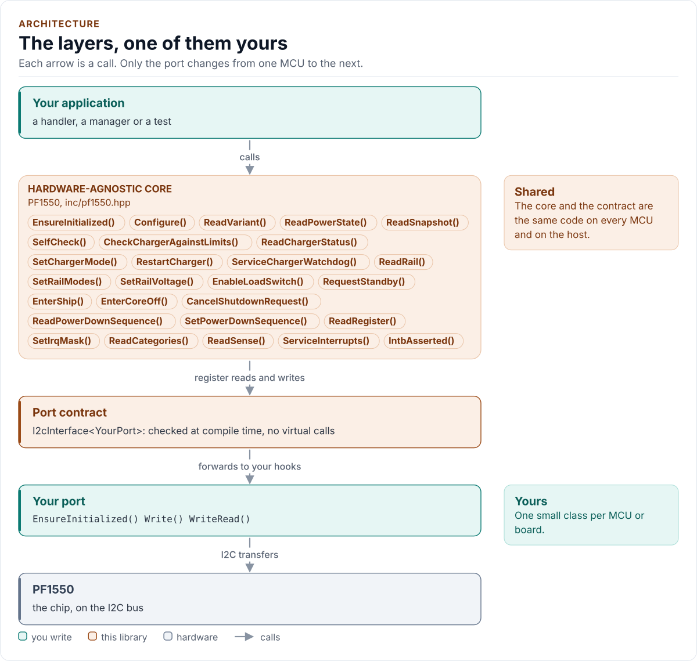
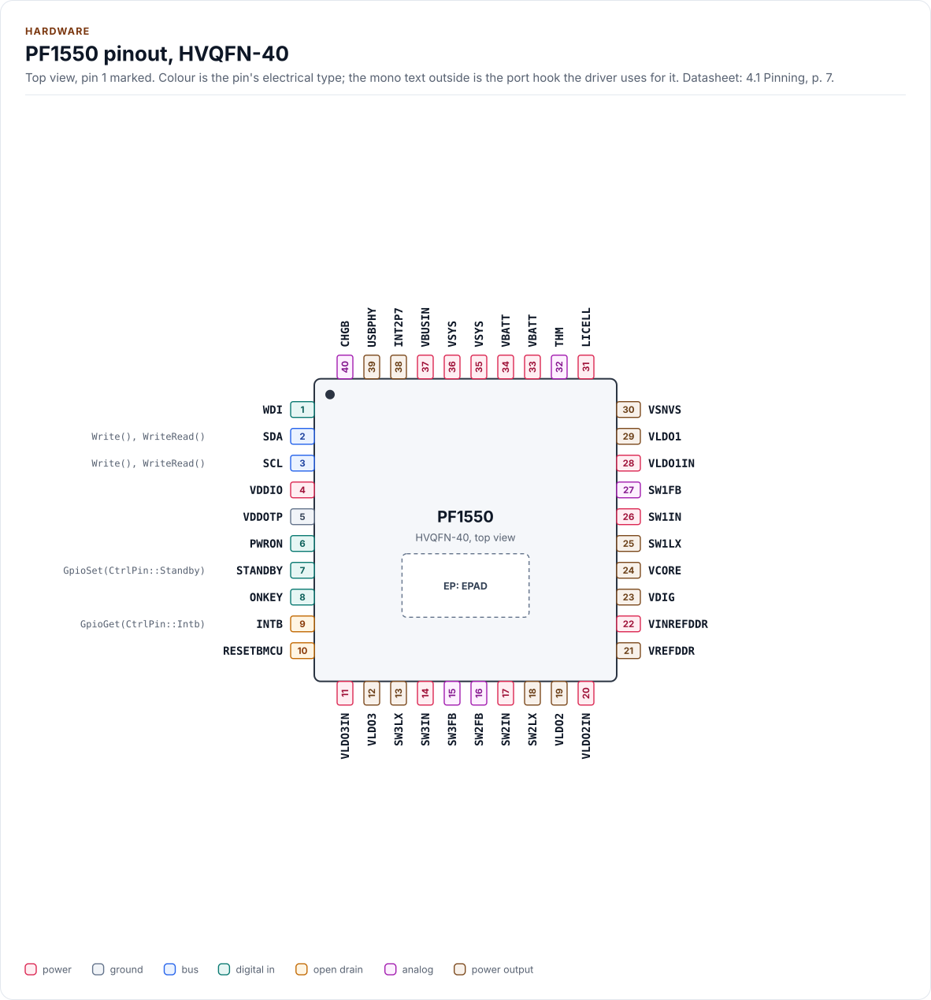
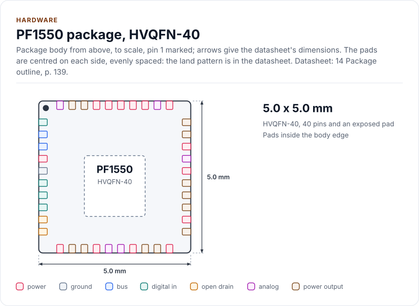
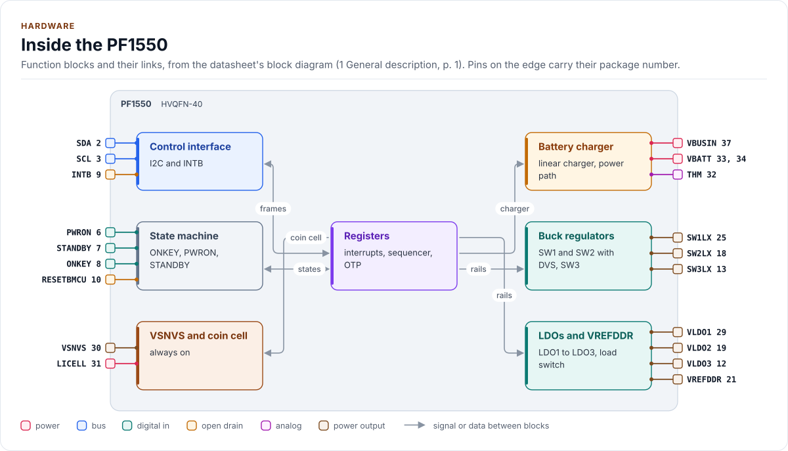

# PF1550 Driver

C++20 driver for the NXP PF1550 power management IC (single-cell Li-ion linear charger, three buck regulators, three
LDOs) on I2C

[](https://github.com/kokeb-labs-drivers/driver-pf1550/actions/workflows/ci.yml)
[](LICENSE)
[](docs/installation.md#requirements)

**Documentation: [`docs/`](docs/index.md)**, with the API reference built by Doxygen ([how](docs/api-reference.md)).
The site at <https://kokeb-labs-drivers.github.io/driver-pf1550/> opens when the repository is public.


The PF1550 is a single-cell power management IC: a linear Li-ion charger with a power path, three buck regulators (two
with dynamic voltage scaling), three LDOs, a DDR reference, an always-on supply with a coin cell charger and a
power-state machine. A wrong byte can overcharge a cell or overvolt a processor, so this driver has no public raw
register write: every setting is typed, checked against limits you declare, written and read back. It runs on any MCU:
you give it a small class that moves bytes on your I2C bus, and it does the rest.

<!-- figure: driver-layers -->
<picture>
  <source media="(prefers-color-scheme: dark)" srcset="docs/diagrams/driver-layers.dark.svg">
  
</picture>
<!-- /figure -->

## At a glance

| | |
| --- | --- |
| **Chip** | NXP PF1550 PMIC, 40-pin HVQFN, 4.1 V to 6.0 V charger input, 1.7 V to 3.3 V I/O |
| **Charger** | Linear charger with power path, 3.5 V to 4.44 V, 100 mA to 1 A, JEITA, watchdog, LED driver |
| **Rails** | SW1 and SW2 (DVS), SW3, LDO1 to LDO3 (two load switches), VREFDDR, VSNVS and a coin cell charger |
| **Bus** | I2C up to 400 kHz, 7-bit address `0x08` to `0x0F` set by OTP, single-register transfers |
| **Also drives** | STANDBY (optional `GpioSet()`) and reads INTB (optional `GpioGet()`) |
| **Driver** | Header-only C++20; no heap, exceptions, RTTI or virtual calls; every call returns `Result<T>` |
| **Safety** | Mandatory `Limits`, explicit acknowledgements, read-back of every write, guarded SHIP and CORE_OFF |
| **Runs on** | Any MCU with I2C and a C++20 compiler; the host example runs on any PC ([Platforms](docs/platforms.md)) |
| **Status** | 0.1.0, not yet verified on hardware: host-tested against a register model of the chip |

<!-- figure: chip-pinout -->
<picture>
  <source media="(prefers-color-scheme: dark)" srcset="docs/diagrams/chip-pinout.dark.svg">
  
</picture>
<!-- /figure -->

<!-- figure: chip-outline -->
<picture>
  <source media="(prefers-color-scheme: dark)" srcset="docs/diagrams/chip-outline.dark.svg">
  
</picture>
<!-- /figure -->

<!-- figure: chip-blocks -->
<picture>
  <source media="(prefers-color-scheme: dark)" srcset="docs/diagrams/chip-blocks.dark.svg">
  
</picture>
<!-- /figure -->

<!-- generated: chip-card -->
| | | Datasheet |
| --- | --- | --- |
| **Package** | HVQFN-40, exposed pad | 4.1, p. 7 |
| **Pins** | 40 | 4.1, p. 7 |
| **Body size** | 5.0 x 5.0 mm | 14, p. 139 |
| **Supply VDDIO** | 1.7 V to 3.3 V | 4.2, p. 8 |

From [`docs/hardware.yml`](docs/hardware.yml); pins, circuits and the block diagram: [Hardware](docs/hardware.md).
<!-- /generated -->

## Datasheet

<!-- generated: datasheet-card -->
| Document | Revision | Get it |
| --- | --- | --- |
| Datasheet: PF1550 Power management integrated circuit (PMIC) for low power application processors (NXP Semiconductors PF1550) | 7, 2021-09-29 | [vendor page](https://www.nxp.com/docs/en/data-sheet/PF1550.pdf) |

Written against these revisions; the SHA-256 of each file is in [`docs/datasheets.yml`](docs/datasheets.yml). Where each
part of the driver is in the datasheet: [Datasheet map](docs/datasheet.md).
<!-- /generated -->

Every docs page lists the datasheet sections it relies on, and code comments cite the section they implement.

## Try it on your PC

No hardware needed: [`examples/host`](examples/host/README.md) runs the driver against a simulated chip.
You need git, CMake 3.16+ and a C++20 compiler (GCC 10+, Clang 13+ or MSVC 2022).

1. Get the source:

   ```bash
   git clone https://github.com/kokeb-labs-drivers/driver-pf1550.git && cd driver-pf1550
   ```

2. Build and run the example:

   ```bash
   cmake -S examples/host -B build-example
   cmake --build build-example
   ./build-example/pf1550_host_example
   ```

3. You should see the driver start the simulated chip, configure the charger and LDO1, and read them back:

   ```text
   PF1550 driver 0.1.0 on the host
   pf1550: initialised
   charger state 1, fault 0, VBUS valid 1
   LDO1 1800000 uV, run 1
   0 interrupt passes
   ```

To run the whole test suite instead: `cmake -S . -B build -DPF1550_BUILD_TESTS=ON && cmake --build build && ctest
--test-dir build`.

## Use it on your MCU

**1. Wire it** ([Hardware](docs/hardware.md) has every pin, the bus settings and the power):

| MCU | PF1550 | Notes |
| --- | --- | --- |
| I2C SCL | SCL | Pull-up to VDDIO; up to 400 kHz |
| I2C SDA | SDA | Pull-up to VDDIO |
| GPIO output | STANDBY | Optional: lets `RequestStandby()` drive the pin |
| GPIO input | INTB | Optional, open drain: lets `ServiceInterrupts()` skip the bus while INTB is high |
| 1.7 V to 3.3 V | VDDIO | The I/O supply |
| GND | GND, VDDOTP, exposed pad | |

**2. Write the port**: a class with `EnsureInitialized()` (bring the bus up), `Write()` and `WriteRead()` (one I2C
transaction each) and `DelayUs()`, about 25 lines on most SDKs. [Porting](docs/porting.md) has the contract and a
complete example.

**3. Describe your hardware and start the chip.** `Limits` is what your cell, supply and loads tolerate. It has no
defaults: a configuration without it is rejected before anything is sent.

<!-- generated: quickstart-code -->
```cpp
#include "pf1550.hpp"

int start_pmic(MyPort& port) {
  pf1550::Config config{};
  config.limits.cell_max_mv = 4200;          // from your cell's data sheet
  config.limits.cell_max_charge_ma = 500;    // from your cell's data sheet
  config.limits.input_max_ma = 1000;         // what your supply delivers
  pf1550::PF1550<MyPort> pmic(port, config); // no I/O yet

  if (auto r = pmic.EnsureInitialized(); !r) { // 1. bus up, DEVICE_ID, charger as found
    return static_cast<int>(r.error); //    NoDevice, DeviceIdMismatch, Unsafe, OutOfLimits ...
  }
  const auto status = pmic.ReadChargerStatus(); // 2. read only
  if (!status) {
    return static_cast<int>(status.error);
  }
  return static_cast<int>(status.value.fault); // 3. 0 is Fault::None
}
```
<!-- /generated -->

`EnsureInitialized()` is the only call that starts the driver. Every other call returns `Error::NotInitialized`
until it has succeeded, and no call ever starts the chip on its own. At start-up the driver also reads the charger
as found: some pre-programmed options turn it on with the charge timer off (Table 85 of the datasheet), and the
driver reports that against your limits before it writes anything.

## What it does

- Starts the driver safely: validates the configuration, checks DEVICE_ID, checks the charger as found and
  reports or switches off an unsafe charge (your choice, `AsFoundPolicy`).
- Writes the charger (voltage, current, input limit, timers, thermistor, JEITA, watchdog, battery FET) in the order
  the datasheet needs, with the mode last, and enables charging only through `SetChargerMode()`.
- Controls the three bucks (DVS voltage steps with a bounded DVS-done wait), the three LDOs (low-power mode, one-way
  load switch), VREFDDR, VSNVS, the coin cell charger, the USBPHY LDO and the charger LED.
- Reads the state machine, the charger status with a classified fault, every interrupt group, and a diagnostic
  snapshot; handles INTB with clear-after-copy semantics.
- Guards the dangerous: SHIP and CORE_OFF need a confirmation token and their preconditions; the power-down order
  needs an acknowledgement; hard-reset paths and the undervoltage threshold need one each.
- Models the power-up and power-down sequencer of the datasheet as pure `constexpr` functions.
- Returns `Result<T>` from every call: no exceptions, no heap, no RTTI, no virtual calls.

## Add it to your project

Pick the row that matches your build; each is a few steps, and [Installation](docs/installation.md) has the
details.

| Your build | Steps below |
| --- | --- |
| Plain CMake: STM32 (CubeMX), RP2040 (Pico SDK), nRF Connect, a host app | [A](#a-cmake-any-mcu) |
| ESP-IDF | [B](#b-esp-idf) |
| An SDK or OS image that installs libraries | [C](#c-installed-package) |

### A. CMake, any MCU

1. Add the driver as a submodule, pinned to the version you chose:

   ```bash
   git submodule add https://github.com/kokeb-labs-drivers/driver-pf1550.git external/driver-pf1550
   ```

2. In your `CMakeLists.txt`, after `project()`:

   ```cmake
   add_subdirectory(external/driver-pf1550)
   target_link_libraries(my_app PRIVATE pf1550::pf1550)   # brings the headers and C++20
   ```

3. In your code, `#include "pf1550.hpp"`, write the port ([Porting](docs/porting.md)) and build. A first build
   that compiles the quickstart above is the check that the driver is wired in.

### B. ESP-IDF

1. Add the driver under your project's `components/`; ESP-IDF finds it there and names it after the folder:

   ```bash
   git submodule add https://github.com/kokeb-labs-drivers/driver-pf1550.git components/pf1550
   ```

2. In `main/CMakeLists.txt`, list it: `idf_component_register(SRCS "main.cpp" REQUIRES pf1550)`.
3. `idf.py menuconfig` now has a **PF1550 power management IC** menu (cell voltage and current, supply current,
   the as-found policy), and `idf.py build` builds the driver with your app. [`examples/esp32`](examples/esp32) is a
   complete project with a port for the board.

### C. Installed package

1. Install it once into a prefix:

   ```bash
   cmake -S external/driver-pf1550 -B build-pf1550 && cmake --install build-pf1550 --prefix /opt/sdk
   ```

2. In your project, with `CMAKE_PREFIX_PATH=/opt/sdk`:

   ```cmake
   find_package(pf1550 0.1 REQUIRED)
   target_link_libraries(my_app PRIVATE pf1550::pf1550)
   ```

The target is `pf1550::pf1550` every way, so switching later changes nothing else.

## Documentation

| Page | Read it when you want to |
| --- | --- |
| [Quickstart](docs/quickstart.md) | Go from a bare chip to a configured charger and rail on your MCU |
| [Hardware](docs/hardware.md) | Wire it, check the bus settings, the pins and the power |
| [Porting](docs/porting.md) | Write the port class for your MCU's SDK |
| [API guide](docs/api-guide.md) | Use each call: start, configure, charge, rails, interrupts, power states |
| [Configuration](docs/configuration.md) | Choose every setting, the limits and the acknowledgements |
| [Troubleshooting](docs/troubleshooting.md) | Find the cause of an error or an unexpected state |
| [Contract](docs/contract.md) | Know exactly what the driver promises, needs and returns, and the open questions |
| [Datasheet map](docs/datasheet.md) | Find the datasheet section behind each part of the driver, and what is not covered |
| [Coverage](docs/coverage.md) | See which parts of the chip are modelled, tested or deliberately left out |
| [API reference](docs/api-reference.md) | Look up a class or member (Doxygen; built by CI and locally) |

## Tests and quality

```bash
cmake -S . -B build -DPF1550_BUILD_TESTS=ON && cmake --build build && ctest --test-dir build
```

The host tests run the driver against an independent register model of the chip (reset values, access types,
the sequencer, DVS timing, interrupts), fail every bus transfer in turn, and produce each error the driver can
return. A fuzzer fails, corrupts and replaces what the chip sends back and checks the
driver's promises after every call. CI also builds for Cortex-M and gates coverage, complexity, sanitizers,
fuzzing, clang-tidy, cppcheck and the handbook rules (`.kokeb/handbook.yml`). See [Testing and CI](docs/testing.md),
which lists every gate and its limit.

## License

MIT. See [LICENSE](LICENSE).
