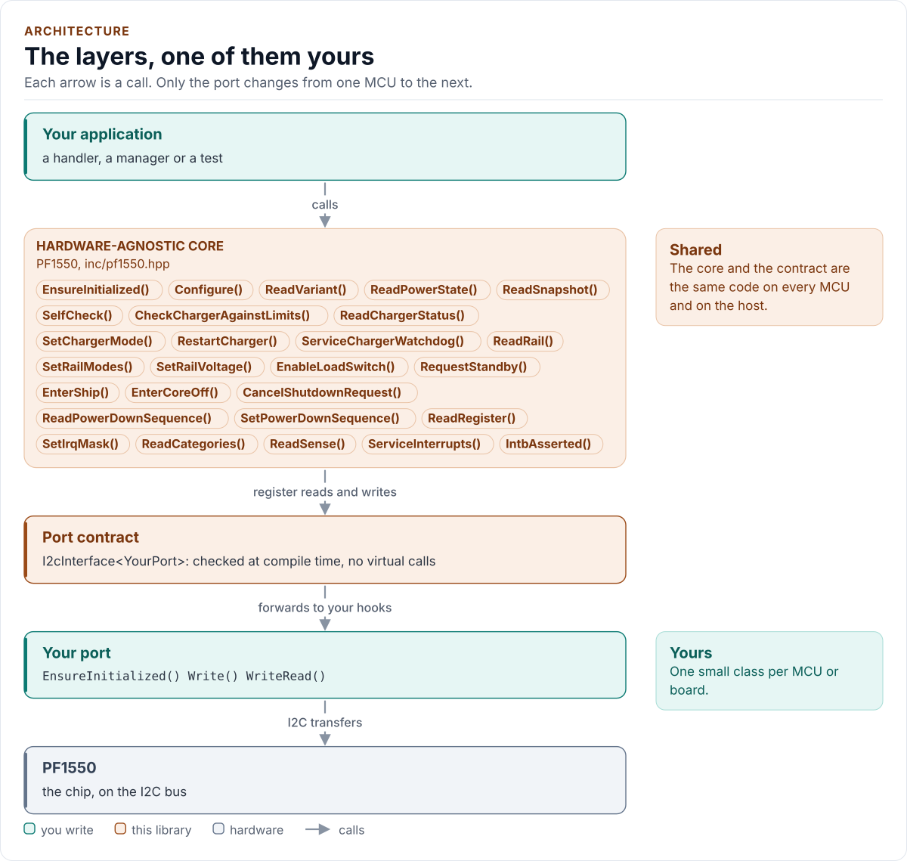
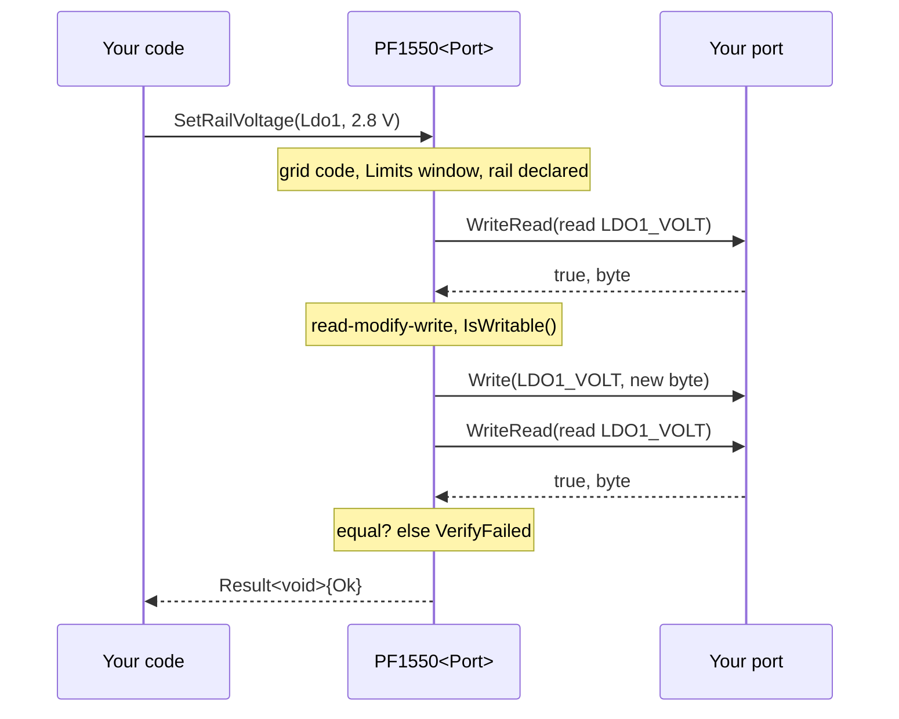

# Architecture

How the driver is built: three layers, one of them yours, and what happens in each when you change a setting.

<!-- generated: datasheet-refs -->
??? abstract "Datasheet sections this page relies on"

    From NXP Semiconductors PF1550 7:

    - I2C address, clock and register framing: 9.7 Control interface I2C block description, p. 71
    - I2C operation: single-register transfers: 9.7.2 I2C operation, p. 72
    - State machine and transitions: 10 PF1550 state machine, p. 72
    - Register map and access types: 12 Register map, p. 80

    All of them, with the driver API for each: [Datasheet map](datasheet.md).
<!-- /generated -->

<!-- figure: driver-layers -->
<picture>
  <source media="(prefers-color-scheme: dark)" srcset="diagrams/driver-layers.dark.svg">
  
</picture>
<!-- /figure -->

## Layers

| Layer | Files | Owns |
| --- | --- | --- |
| Core | [`inc/pf1550.hpp`](../inc/pf1550.hpp), [`src/pf1550.ipp`](../src/pf1550.ipp) | Lifecycle, the typed calls, the guards, the read-back, the bounded waits, errors |
| Configuration | [`inc/pf1550_config.hpp`](../inc/pf1550_config.hpp), [`inc/pf1550_codec.hpp`](../inc/pf1550_codec.hpp) | `Limits`, `Acknowledgements`, every block of `Config`, `Validate()`; the datasheet grids as `constexpr` codecs |
| Plans | [`inc/pf1550_plan.hpp`](../inc/pf1550_plan.hpp) | A block turned into a list of `{register, mask, value}` writes, as pure `constexpr` functions |
| Types and registers | [`inc/pf1550_types.hpp`](../inc/pf1550_types.hpp), [`inc/pf1550_registers.hpp`](../inc/pf1550_registers.hpp) | `Error`, `Result<T>`, the enumerations; the register map with each register's access type |
| Interrupts | [`inc/pf1550_irq.hpp`](../inc/pf1550_irq.hpp) | The 31 sources: where each lives, the categories, fault classification |
| Sequencer | [`inc/pf1550_sequencer.hpp`](../inc/pf1550_sequencer.hpp) | The start-up options of Table 85 and the power-up and power-down timing, as `constexpr` data |
| Port contract | [`inc/pf1550_i2c_interface.hpp`](../inc/pf1550_i2c_interface.hpp) | The CRTP base, `CtrlPin`, `GpioSignal`, `I2cFailure`, the `I2cPort` concept, the register framing |
| Platform port | Your class | Bus bring-up and byte transfers, the delay, optionally STANDBY, INTB, the failure report and logging |
| Kconfig layer | [`inc/pf1550_kconfig.hpp`](../inc/pf1550_kconfig.hpp) | Optional: the limits from ESP-IDF menuconfig |

## One call through the layers

A write is always a read, a masked change, a write and a read. `Configure()` is the same, applied to the plan of each
block, with the charger last: a plan is a short list of `{register, mask, value}` entries that a test can check
without a bus.

## Design choices

- **No raw write.** A byte reaches the chip only through one private function that refuses a register the datasheet
  does not document as writable. The public API is typed: enumerations, grids and codecs, so a value is on the
  datasheet's table before it becomes a register field.
- **Limits first.** The application states what its cell, supply and loads tolerate; the driver refuses what exceeds it
  (`OutOfLimits`) and what lowers a protection without an acknowledgement (`Unsafe`).
- **Plans, not branches.** Each block is a pure function to a list of writes. The code that applies them is one
  loop, so the guards and the read-back are in one place and the complexity stays low.
- **Charger parked.** The charger is set to "linear only" before its parameters change and its mode is written last,
  because the datasheet does not say whether a parameter change is glitch-free (ambiguities C16 and C49).
- **CRTP, not virtual functions.** The port is a template parameter constrained by the `I2cPort` concept, so every
  call is resolved at compile time and a missing hook is a compile error that names it.
- **Optional hooks by named concepts.** `GpioSet`, `GpioGet`, `GetLastFailure` and `Log` are detected with C++20
  concepts in one place. A hook that is declared with the wrong signature is a compile error; one that is absent
  changes the call's result (`Unsupported`), never silently skips a step. `DelayUs()` is required.
- **No I/O in the constructor.** Construction cannot fail, so the driver can be a static or a member of a handler.
- **One error type.** `Result<T>` carries a value and an `Error`; nothing throws and nothing returns a bare `bool`.
- **No heap, no exceptions, no RTTI, no `std::function`, no `printf`.** The driver is a header-only template with no
  mutable static state.

## Source map

| You want | Read |
| --- | --- |
| The public API | [`inc/pf1550.hpp`](../inc/pf1550.hpp) |
| How a call is implemented | [`src/pf1550.ipp`](../src/pf1550.ipp) |
| The configuration and its checks | [`inc/pf1550_config.hpp`](../inc/pf1550_config.hpp) |
| Register addresses, bits and access types | [`inc/pf1550_registers.hpp`](../inc/pf1550_registers.hpp) |
| The sequencer model | [`inc/pf1550_sequencer.hpp`](../inc/pf1550_sequencer.hpp) |
| The port contract | [`inc/pf1550_i2c_interface.hpp`](../inc/pf1550_i2c_interface.hpp) |

Next: [Contract](contract.md).
