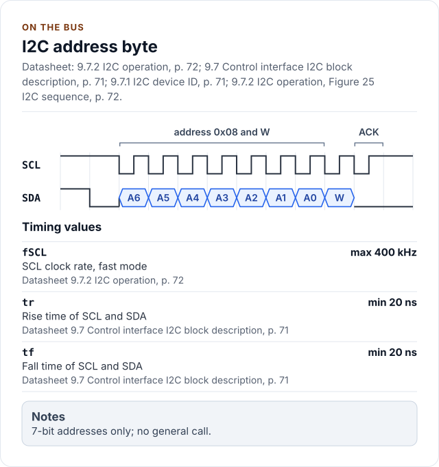

# On the bus

What the PF1550 needs from the I2C bus, with every rate and limit taken from the data sheet. The connections are on
the [Hardware](hardware.md) page; this page is the waveform under them.

## I2C timing

The PF1550 follows the I2C fast mode, up to 400 kbit/s (`kMaxClockHz`), with 7-bit addresses only and no general
call (section 9.7.2). The rise and fall times of SCL and SDA must exceed 20 ns: slow the master's drive if they do not
(section 9.7). The data sheet gives no I2C timing table of its own and refers to the I2C-bus specification for every
interval, so the figure draws the address byte and the limits the data sheet states. A whole register read (write
the register address, repeated START, read one byte, NACK, STOP; Figure 25) is drawn on the
[Hardware](hardware.md#bus-settings) page.

<!-- figure: i2c-timing -->
<picture>
  <source media="(prefers-color-scheme: dark)" srcset="diagrams/i2c-timing.dark.svg">
  
</picture>
<!-- /figure -->

## Several devices

The data sheet gives one address, `0x08`, for the PF1550 (section 9.7.1) and for every pre-programmed OTP option of
Table 85 (p. 79), and describes no way to share a bus with a second PF1550; the read-only I2C_ADDR register decodes
fuse codes for `0x08` to `0x0F` (Table 147, p. 104), so a part fused to another code answers there. Other chips on
the same bus need addresses other than the PF1550's.

## How these figures are made

The figure is a model in `docs/model/` (`i2c-timing.timing.yml`) that cites the data sheet section and page of every
number; `kokeb-docs figures` draws it and the build fails on a number without a citation. The values table under the
waveform is also written as `docs/diagrams/i2c-timing.table.html`.
