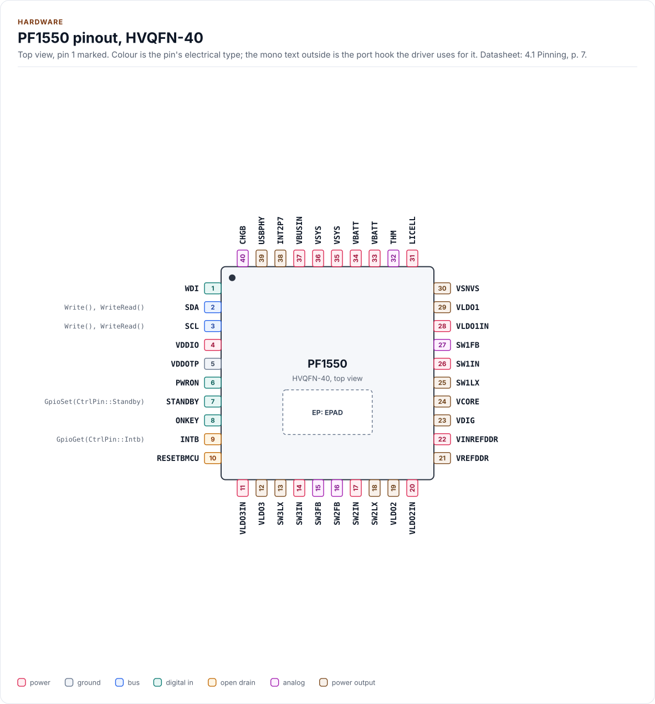
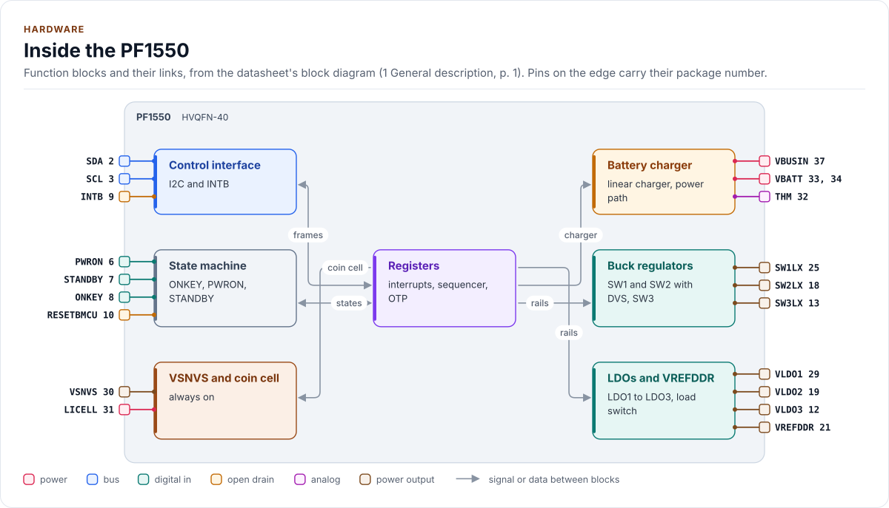
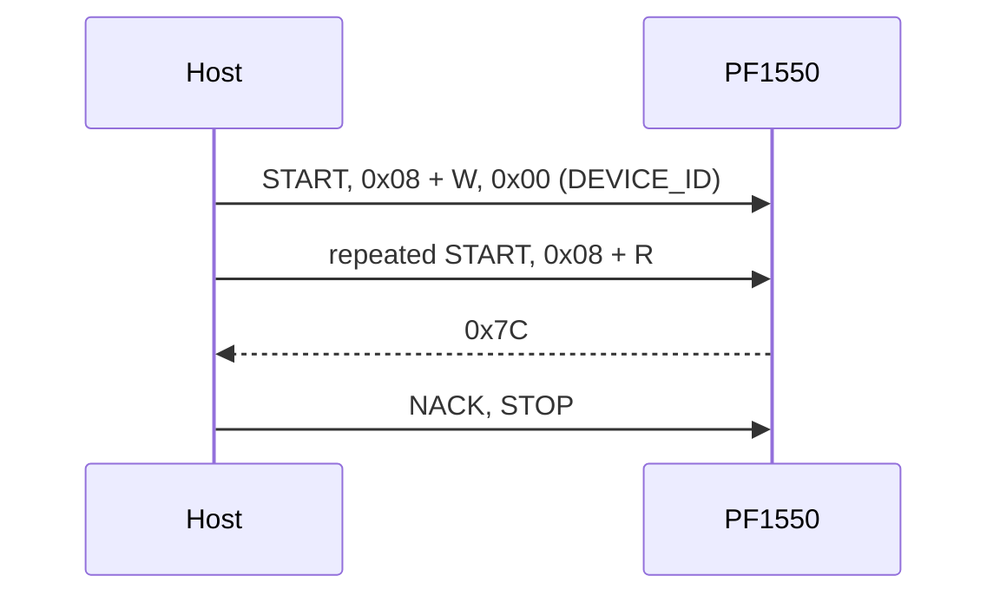
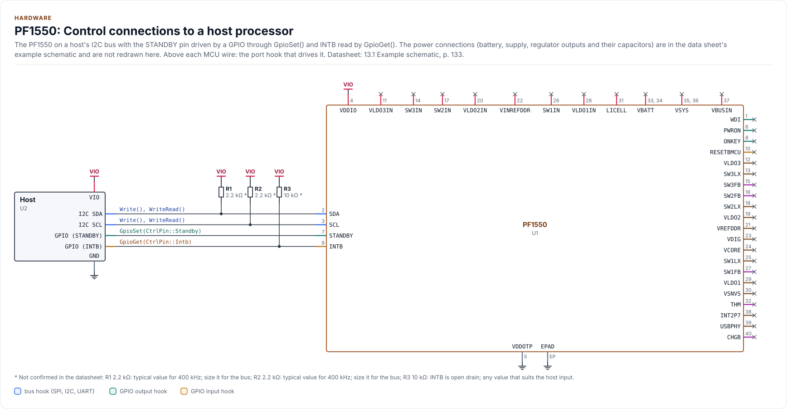

# Hardware

The PF1550's package, pins, bus settings and power, as the driver uses them. The driver reaches the chip through the
I2C bus and two optional pins, STANDBY and INTB; everything else on the package is wired by the board, as the
datasheet's example schematic shows (section 13.1, p. 133).

<!-- generated: datasheet-refs -->
??? abstract "Datasheet sections this page relies on"

    From NXP Semiconductors PF1550 7:

    - Pins and package: 4.2 Pin definitions, p. 8
    - I2C address, clock and register framing: 9.7 Control interface I2C block description, p. 71
    - Example schematic: 13.1 Example schematic, p. 133
    - Package outline: 14 Package outline, p. 139

    All of them, with the driver API for each: [Datasheet map](datasheet.md).
<!-- /generated -->

## Package

HVQFN-40, 5.0 mm x 5.0 mm with an exposed pad (data sheet section 14, p. 139). The exposed pad is ground. The body
size is the only dimension the datasheet text gives; the pitch and the height are on its drawing and are not drawn
here.

## Pins

<!-- figure: chip-pinout -->
<picture>
  <source media="(prefers-color-scheme: dark)" srcset="diagrams/chip-pinout.dark.svg">
  
</picture>
<!-- /figure -->

<!-- generated: chip-pins -->
HVQFN-40, 40 pins and an exposed pad (4.1 Pinning, p. 7).

| Pin | Name | Type (domain) | Function | Driver hook | If unused | Datasheet |
| --- | --- | --- | --- | --- | --- | --- |
| 1 | `WDI` | digital in (VDDIO) | Watchdog input from the processor | - | - | 4.2, p. 8 |
| 2 | `SDA` | bus (VDDIO) | I2C data | `Write(), WriteRead()` | - | 9.7, p. 71 |
| 3 | `SCL` | bus (VDDIO) | I2C clock, up to 400 kHz | `Write(), WriteRead()` | - | 9.7, p. 71 |
| 4 | `VDDIO` | power (VDDIO) | I/O supply, 1.7 V to 3.3 V | - | - | 4.2, p. 8 |
| 5 | `VDDOTP` | ground | Connect to ground in the application | - | - | 4.2, p. 8 |
| 6 | `PWRON` | digital in (VDDIO) | PWRON input | - | - | 9.1, p. 68 |
| 7 | `STANDBY` | digital in (VDDIO) | STANDBY input; the driver drives it | `GpioSet(CtrlPin::Standby)` | Leave low (STANDBYINV = 0) | 9.2, p. 69 |
| 8 | `ONKEY` | digital in (VDDIO) | ONKEY push-button input | - | - | 9.6, p. 71 |
| 9 | `INTB` | open drain (VDDIO) | Interrupt output, active low | `GpioGet(CtrlPin::Intb)` | Leave open; poll with ServiceInterrupts() | 9.4, p. 70 |
| 10 | `RESETBMCU` | open drain (VDDIO) | Reset output to the processor | - | - | 9.3, p. 69 |
| 11 | `VLDO3IN` | power (VSYS) | LDO3 input supply | - | - | 7, p. 34 |
| 12 | `VLDO3` | power output (VLDO3) | LDO3 output | - | - | 7, p. 34 |
| 13 | `SW3LX` | power output (SW3) | Buck 3 switching node | - | - | 6, p. 24 |
| 14 | `SW3IN` | power (VSYS) | Buck 3 input supply | - | - | 6, p. 24 |
| 15 | `SW3FB` | analog (SW3) | Buck 3 output voltage feedback | - | - | 6, p. 24 |
| 16 | `SW2FB` | analog (SW2) | Buck 2 output voltage feedback | - | - | 6, p. 24 |
| 17 | `SW2IN` | power (VSYS) | Buck 2 input supply | - | - | 6, p. 24 |
| 18 | `SW2LX` | power output (SW2) | Buck 2 switching node | - | - | 6, p. 24 |
| 19 | `VLDO2` | power output (VLDO2) | LDO2 output | - | - | 7, p. 34 |
| 20 | `VLDO2IN` | power (VSYS) | LDO2 input supply | - | - | 7, p. 34 |
| 21 | `VREFDDR` | power output (VREFDDR) | VREFDDR output | - | - | 7, p. 34 |
| 22 | `VINREFDDR` | power (VSYS) | VREFDDR input supply | - | - | 7, p. 34 |
| 23 | `VDIG` | power output (INT) | Digital regulator output, used inside the chip | - | - | 4.2, p. 8 |
| 24 | `VCORE` | power output (INT) | Core regulator output, used inside the chip | - | - | 4.2, p. 8 |
| 25 | `SW1LX` | power output (SW1) | Buck 1 switching node | - | - | 6, p. 24 |
| 26 | `SW1IN` | power (VSYS) | Buck 1 input supply | - | - | 6, p. 24 |
| 27 | `SW1FB` | analog (SW1) | Buck 1 feedback input | - | - | 6, p. 24 |
| 28 | `VLDO1IN` | power (VSYS) | LDO1 input supply | - | - | 7, p. 34 |
| 29 | `VLDO1` | power output (VLDO1) | LDO1 output | - | - | 7, p. 34 |
| 30 | `VSNVS` | power output (VSNVS) | VSNVS regulator output | - | - | 7, p. 34 |
| 31 | `LICELL` | power (LICELL) | Coin cell input and charger output | - | - | 4.2, p. 8 |
| 32 | `THM` | analog (INT) | Thermistor connection; connect the thermistor to ground | - | - | 4.2, p. 8 |
| 33 | `VBATT` | power (VBATT) | Battery input | - | - | 4.2, p. 8 |
| 34 | `VBATT` | power (VBATT) | Battery input | - | - | 4.2, p. 8 |
| 35 | `VSYS` | power (VSYS) | Main input of the PMIC and output of the charger | - | - | 4.2, p. 8 |
| 36 | `VSYS` | power (VSYS) | Main input of the PMIC and output of the charger | - | - | 4.2, p. 8 |
| 37 | `VBUSIN` | power (VBUS) | Charger input | - | - | 4.2, p. 8 |
| 38 | `INT2P7` | power output (INT) | 2.7 V regulator output, also the thermistor bias | - | - | 4.2, p. 8 |
| 39 | `USBPHY` | power output (USBPHY) | USBPHY regulator output | - | - | 4.2, p. 8 |
| 40 | `CHGB` | analog (VSYS) | Charger LED connection; the LED goes from VSYS to this pin | - | - | 4.2, p. 8 |
| EP | `EPAD` | ground | Exposed pad; connect to ground | - | - | 4.2, p. 8 |

Source of this table and of the chip figures: [`docs/hardware.yml`](hardware.yml).
<!-- /generated -->

The driver uses SDA and SCL through the port, STANDBY through `GpioSet(CtrlPin::Standby, ...)` and INTB through
`GpioGet(CtrlPin::Intb, ...)`. It never touches the other pins: PWRON, ONKEY, WDI and RESETBMCU belong to the board
and the state machine. The driver reads their effect (state, interrupts) and configures their debounce and polarity
where the datasheet makes them registers.

## Blocks

<!-- figure: chip-blocks -->
<picture>
  <source media="(prefers-color-scheme: dark)" srcset="diagrams/chip-blocks.dark.svg">
  
</picture>
<!-- /figure -->

The register map is split in two pages by address: the PMIC registers `0x00` to `0x6F` and the charger registers
`0x80` to `0x9F`, both on the same I2C address.

## Control pins

- **STANDBY** is an input of the chip. `RequestStandby(true)` calls your
  `GpioSet(CtrlPin::Standby, GpioSignal::ACTIVE)`; `ACTIVE` means "request STANDBY" and your port maps the polarity
  (`STANDBYINV` = 0 is active high). The driver
  never writes `STANDBYINV` unless `PowerConfig::apply` is set: change the polarity only together with the port.
  Without the hook `RequestStandby()` returns `Unsupported`.
- **INTB** is an open-drain output, low when an unmasked interrupt is pending. With `GpioGet()`,
  `ServiceInterrupts()` returns an empty result without bus traffic while INTB is high. Without it, every call reads
  `INT_CATEGORY`.
- **PWRON, ONKEY, WDI, RESETBMCU** are not driver pins. PWRON level or edge sensitivity is an OTP option
  (`OTP_PWRON_CFG`, option A8 is edge sensitive) and the driver cannot read it.

## Bus settings

| Setting | Value |
| --- | --- |
| Clock | Up to 400 kHz (`kMaxClockHz`), fast mode |
| Address | 7-bit, `0x08` to `0x0F` set by OTP (`kI2cAddress` = `0x08`); pass it to the constructor |
| Write | START, address + W, register, one data byte, STOP |
| Read | START, address + W, register, repeated START, address + R, one data byte, STOP |
| Burst | Not used: the datasheet does not describe auto-increment (ambiguity C48) |
| I/O levels | Set by VDDIO, 1.7 V to 3.3 V |

An address that nothing acknowledges (no chip, no power, a wrong address) is reported as `Error::NoDevice` when your
port has the optional `GetLastFailure()` hook; without it the driver cannot tell it from another bus fault and returns
`Bus`.

## Power

The PF1550 powers itself from VSYS and VBUSIN; the driver has no supply of its own to manage. The limits the driver
needs from you describe what the cell and the loads tolerate ([Configuration](configuration.md#limits)).

| Rail | What the datasheet gives | Driver |
| --- | --- | --- |
| VBUSIN | VUVLO rising 3.8 V to 4.2 V (valid above it) up to OVLO rising 6.0 V to 7.0 V (Table 5; ambiguity C52) | Status only (`VbusFlags`) |
| VBATT | Single Li-ion cell, charge voltage 3.5 V to 4.44 V | `Limits::cell_max_mv` |
| VDDIO | 1.7 V to 3.3 V | The port's concern |
| SW1, SW2, SW3 | Programmable bucks | `Limits::rail[...]` |
| LDO1 to LDO3, VREFDDR | Programmable LDOs, fixed reference | `Limits::rail[...]` |
| LICELL | Coin cell, charged to 1.8 V to 3.3 V | `Limits::coin_cell_max_mv` |

## Reference application circuit

The datasheet's example schematic (section 13.1, p. 133) shows the power connections: the charger input, the battery,
the three bucks with their inductors, the LDOs and their capacitors, the thermistor, the LED and the coin cell. It is
not redrawn here. The figure below is only the control connections of a host, as the driver uses them; the resistor
values are typical and marked as not confirmed.

<!-- figure: chip-circuit-typical -->
<picture>
  <source media="(prefers-color-scheme: dark)" srcset="diagrams/chip-circuit-typical.dark.svg">
  
</picture>
<!-- /figure -->

<!-- generated: chip-parts -->
| Part | Kind | Value | Connects | Datasheet |
| --- | --- | --- | --- | --- |
| U2 | Host | - | VIO: VIO, GND: GND, SDA: SDA, SCL: SCL, STBY: STANDBY, IRQ: INTB | 13.1, p. 133 |
| R1 | resistor | 2.2 kΩ (not confirmed: typical value for 400 kHz; size it for the bus) | VIO, SDA | 13.1, p. 133 |
| R2 | resistor | 2.2 kΩ (not confirmed: typical value for 400 kHz; size it for the bus) | VIO, SCL | 13.1, p. 133 |
| R3 | resistor | 10 kΩ (not confirmed: INTB is open drain; any value that suits the host input) | VIO, INTB | 13.1, p. 133 |

Export a circuit for a schematic or PCB tool: `kokeb-docs hardware --kicad-netlist OUT.net --circuit typical`.
<!-- /generated -->

## Silicon and options

`ReadVariant()` returns DEVICE_ID, `OTP_FLAVOR`, `SILICON_REV` and the address code. The ten orderable options A0
to A9 differ in their OTP start-up values (Table 85): output voltages, the power-up order, the charger's start-up
mode, the input current limit and whether DVS is enabled. The driver reports the option and the sequencer helpers
model the power-up order of A1 to A9 ([API guide](api-guide.md#the-sequencer)).

- **A0** parts are "not programmed, internal validation only" (Table 1 footnote). The driver supports reading them
  and assumes nothing about their start-up values.
- `SILICON_REV` is stored raw and no decision is made on it: the datasheet's text and its register bitmap disagree on
  the reset value (ambiguity C22).
- The OTP image itself is not readable over I2C in the public datasheet, so the driver cannot read the fuses back; it
  asks you for the two OTP facts it needs (`BuckConfig::dvs`, the declared DVS mode) and reports the rest from the
  option byte. See [Datasheet map](datasheet.md#what-is-not-covered).

## Reference documents

The datasheet:
[PF1550 datasheet](https://www.nxp.com/docs/en/data-sheet/PF1550.pdf). Every pin, setting and timing on this page cites
a section of it; its revision, its SHA-256 and the sections each page relies on are in
[`docs/datasheets.yml`](datasheets.yml).

<!-- generated: datasheet-card -->
| Document | Revision | Get it |
| --- | --- | --- |
| Datasheet: PF1550 Power management integrated circuit (PMIC) for low power application processors (NXP Semiconductors PF1550) | 7, 2021-09-29 | [vendor page](https://www.nxp.com/docs/en/data-sheet/PF1550.pdf) |

Written against these revisions; the SHA-256 of each file is in [`docs/datasheets.yml`](datasheets.yml). Where each part
of the driver is in the datasheet: [Datasheet map](datasheet.md).
<!-- /generated -->

| Also useful | Contents |
| --- | --- |
| [`inc/pf1550_registers.hpp`](../inc/pf1550_registers.hpp) | The register map as the driver uses it, with datasheet table numbers |
| [`inc/pf1550_sequencer.hpp`](../inc/pf1550_sequencer.hpp) | The start-up options and the sequencer timing as `constexpr` data |
