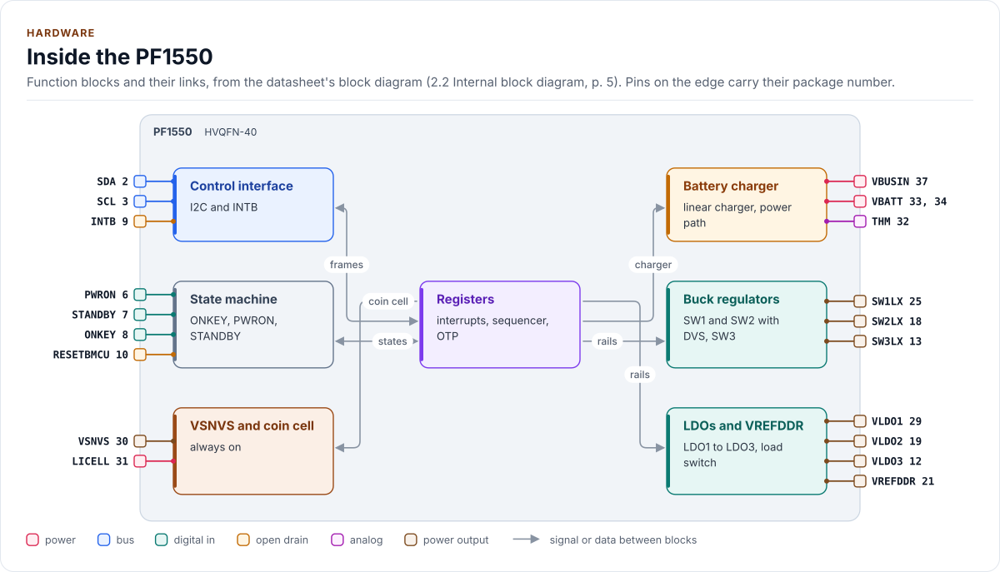
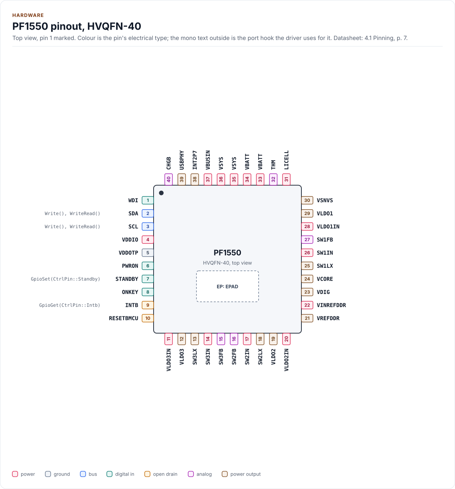
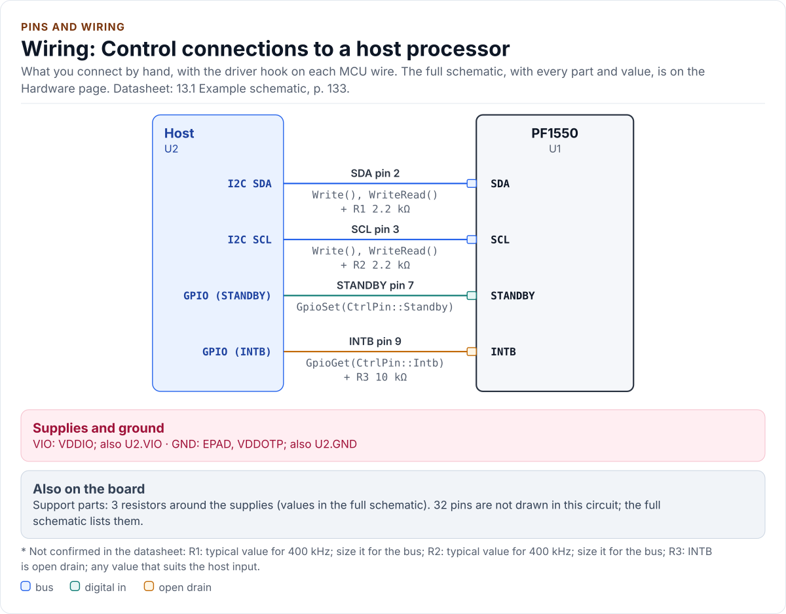

---
hide:
  - navigation
  - toc
---

<div class="kb-hero" markdown>
<span class="kb-kicker">Power management IC with Li-ion charger</span>

# PF1550 Driver

<p>A C++20 driver for the PF1550 power management IC. It starts the chip, checks the charger against limits
you declare, writes a typed configuration with read-back, and controls the charger, the bucks, the LDOs and the
power states, on any MCU.</p>

[Quickstart](quickstart.md){ .md-button .md-button--primary }
[API guide](api-guide.md){ .md-button }
[Source on GitHub](https://github.com/kokeb-labs-drivers/driver-pf1550){ .md-button }
</div>

<!-- generated: chip-summary -->
The **PF1550** is a power management IC for battery-powered boards built around a low-power application processor: it
charges a single Li-ion cell and supplies the processor, the memory and the peripherals from three buck converters,
three linear regulators and an RTC supply (1 General description, p. 1).
<!-- /generated -->

<!-- figure: chip-hero -->
<picture>
  <source media="(prefers-color-scheme: dark)" srcset="diagrams/chip-hero.dark.svg">
  
</picture>
<!-- /figure -->

## What it does

<!-- figure: chip-capabilities -->
<picture>
  <source media="(prefers-color-scheme: dark)" srcset="diagrams/chip-capabilities.dark.svg">
  
</picture>
<!-- /figure -->

## Where it is used

<!-- generated: chip-uses -->
- Smart mobile and wearable devices
- Low-power IoT devices
- Wireless game controllers
- Embedded monitoring systems
- Home automation
- Point-of-sale terminals
- E-readers

Uses named by the datasheet (1.2 Applications, p. 2).
<!-- /generated -->

## Inside the chip

<!-- figure: chip-blocks -->
<picture>
  <source media="(prefers-color-scheme: dark)" srcset="diagrams/chip-blocks.dark.svg">
  
</picture>
<!-- /figure -->

## Pins and wiring

<!-- figure: chip-pinout -->
<picture>
  <source media="(prefers-color-scheme: dark)" srcset="diagrams/chip-pinout.dark.svg">
  
</picture>
<!-- /figure -->

<!-- figure: chip-wiring-typical -->
<picture>
  <source media="(prefers-color-scheme: dark)" srcset="diagrams/chip-wiring-typical.dark.svg">
  
</picture>
<!-- /figure -->

Every pin, the bus settings, the package and the power: [Hardware](hardware.md).

## Quick start

Wire the chip as above, write the port ([Porting](porting.md)), then declare your limits and start the driver:

```cpp
--8<-- "tests/docs/quickstart.cpp:quickstart"
```

The steps explained: [Quickstart](quickstart.md).

## Driver coverage

<!-- generated: chip-coverage -->
| Capability | What the chip does | Driver API | Registers | Status | Datasheet |
| --- | --- | --- | --- | --- | --- |
| [Battery charger](api-guide.md#charge) | Charges one Li-ion cell: charge voltage and current, termination, timers, watchdog and the status LED (charging starts only through SetChargerMode, within the Limits you declare) | `SetChargerMode`, `RestartCharger`, `ServiceChargerWatchdog`, `ReadChargerStatus`, `CheckChargerAgainstLimits` | `CHG_OPER`, `BATT_REG`, `CHG_CURR_CNFG`, `CHG_EOC_CNFG`, `CHG_TMR`, `LED_CNFG` | Supported | 8, p. 42 |
| [Power path](configuration.md#charger-chargerconfig) | Runs the system from the input while the cell charges: input current limit, VSYS minimum, battery FET | `Configure`, `VbusOptions`, `BatfetConfig` | `VBUS_INLIM_CNFG`, `VBUS_LIN_DPM`, `VBUS2SYS_CNFG`, `BATFET_CNFG` | Supported | 8.7, p. 55 |
| [Battery thermistor and JEITA](configuration.md#charger-chargerconfig) | Reads the cell's thermistor and lowers or stops the charge when the cell is too cold or too hot | `Configure`, `JeitaConfig` | `THM_REG_CNFG`, `THM_ADJ_SETTING`, `THM_COLD`, `THM_HOT` | Supported | 8.7.3, p. 56 |
| [Buck regulators](api-guide.md#rails) | Sets SW1 to SW3 per state (run, standby, sleep), with dynamic voltage scaling on SW1 and SW2 | `SetRailVoltage`, `SetRailModes`, `ReadRail`, `BuckConfig` | `SW1_VOLT`, `SW1_CTRL`, `SW2_VOLT`, `SW2_CTRL`, `SW3_VOLT`, `SW3_CTRL` | Supported | 6.1, p. 25 |
| [LDOs, VREFDDR and VSNVS](api-guide.md#rails) | Sets LDO1 to LDO3, the DDR reference, the RTC supply, the coin cell charger and the USB PHY regulator (the LDO1 and LDO3 load switch mode needs a confirmation token) | `SetRailVoltage`, `SetRailModes`, `EnableLoadSwitch`, `LdoConfig`, `CoinCell` | `LDO1_VOLT`, `LDO1_CTRL`, `VREFDDR_CTRL`, `VSNVS_CTRL`, `COINCELL_CONTROL`, `USB_PHY_LDO_CNFG` | Supported | 7, p. 34 |
| [Interrupts and status](api-guide.md#interrupts) | Pulls INTB low on a fault or event; the driver reads, latches and clears each interrupt group | `ServiceInterrupts`, `SetIrqMask`, `ReadCategories`, `GetLatchedEvents`, `ReadSnapshot` | `INT_CATEGORY`, `CHG_INT`, `SW_INT_STAT0`, `LDO_INT_STAT0`, `MISC_INT_STAT0` | Supported | 9.4, p. 70 |
| [Power states and sequencer](api-guide.md#power-states) | Run, standby, sleep, core off and ship states, with the order rails start and stop in (SHIP and CORE_OFF need a confirmation token, the power-down order an acknowledgement) | `RequestStandby`, `EnterShip`, `EnterCoreOff`, `ReadPowerState`, `SetPowerDownSequence` | `PWRCTRL0`, `PWRCTRL3`, `STATE_INFO`, `SW1_PWRDN_SEQ`, `LDO1_PWRDN_SEQ` | Guarded | 10, p. 72 |
| [OTP start-up configuration](datasheet.md#what-is-not-covered) | Fuses hold the start-up sequence, voltages and charger defaults; the driver reads the option, never fuses | `ReadVariant` | `OTP_FLAVOR` | Not covered | 11.2, p. 79 |

**Supported**: the driver covers it and a host test checks it; **Guarded**: covered, behind an explicit acknowledgement
because a wrong value can do harm; **Not covered**: the chip has it and the driver leaves it alone.

From [`docs/hardware.yml`](hardware.yml); `kokeb-docs hardware --check` confirms that every API name is in
`inc/pf1550.hpp`, `inc/pf1550_config.hpp`, `inc/pf1550_types.hpp` and every register in `inc/pf1550_registers.hpp`.
<!-- /generated -->

The driver has no platform code. You give it a small class that brings the bus up and moves bytes; it does the
rest: the limit and acknowledgement checks, the register framing, the write order the datasheet needs, the read-backs,
the bounded waits and the error mapping.

- **One object per chip.** `PF1550<YourPort>` takes a reference to your port and a `Config`, and does no I/O until
  `EnsureInitialized()`. See [API guide](api-guide.md).
- **Safety by construction.** No public raw write; mandatory `Limits`; acknowledgements for every downgrade; every
  write read back. See [Contract](contract.md) and [Configuration](configuration.md).
- **Errors you can act on.** Every call returns `Result<T>` with an `Error` such as `Bus`, `Unsafe`, `OutOfLimits` or
  `Refused`. See [API guide](api-guide.md#handle-errors).
- **The whole chip.** Charger, bucks, LDOs, VSNVS, coin cell, USBPHY, LED, power states, sequencer and interrupts; the
  [coverage](coverage.md) page lists what is modelled and what is not.
- **Zero-overhead portability.** The port is a CRTP class checked by a concept: the bus hooks and a delay, plus
  optional STANDBY, INTB, failure-report and logging hooks found at compile time. See [Porting](porting.md).
- **No heap, no exceptions, no RTTI.** The host tests build with `-fno-exceptions -fno-rtti`.
- **Tested without hardware.** Host tests run the driver against an independent register model of the chip. See
  [Testing and CI](testing.md). Nothing is verified on hardware yet.

## Datasheet

<!-- generated: datasheet-card -->
| Document | Revision | Get it |
| --- | --- | --- |
| Datasheet: PF1550 Power management integrated circuit (PMIC) for low power application processors (NXP Semiconductors PF1550) | 7, 2021-09-29 | [vendor page](https://www.nxp.com/docs/en/data-sheet/PF1550.pdf) |

Written against these revisions; the SHA-256 of each file is in [`docs/datasheets.yml`](datasheets.yml). Where each part
of the driver is in the datasheet: [Datasheet map](datasheet.md).
<!-- /generated -->

## Where to go next

<div class="grid cards" markdown>

-   :material-rocket-launch-outline: **[Quickstart](quickstart.md)**

    ---

    Wire the chip, write the port, start the driver and read the charger.

-   :material-chip: **[Hardware](hardware.md)**

    ---

    Pins, bus settings, the package and the power.

-   :material-file-document-check-outline: **[Contract](contract.md)**

    ---

    What the driver promises, what it needs, threading, errors and the open questions.

-   :material-code-braces: **[API guide](api-guide.md)**

    ---

    Start, configure, charge, control rails and handle errors, task by task.

-   :material-swap-horizontal: **[Porting](porting.md)**

    ---

    Implement the port for your MCU.

-   :material-book-open-variant: **[API reference](api-reference.md)**

    ---

    Every class and member, generated from the headers.

</div>
